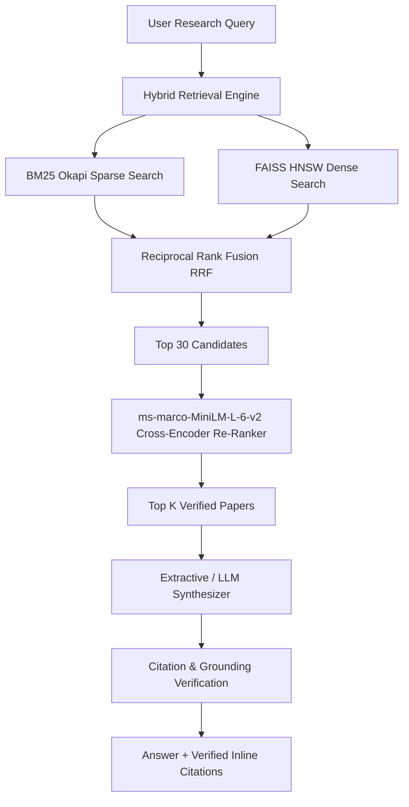

# Research Copilot: Production AI Academic Search, Topic Map & Q&A

An end-to-end AI system for scientific discovery, semantic paper exploration, and cited academic question answering over **16,417 arXiv papers** across 35 computer science categories (2020–2026).

---

## 1. System Architecture



---

## 2. Dataset & Chronological Date Splits

All evaluations are conducted under **strict chronological split discipline** to reflect true production deployment:

- **Total Corpus**: **16,417 papers** (SHA-256: `74ab929134a75386a5e8da06e08588eb02d5f1390c948b14f4b533defa863e18`)
- **Training Set (<= 2026-04-30)**: 14,629 papers (historical training corpus)
- **Validation Set (2026-05-01 to 2026-07-31)**: 898 papers (used strictly for hyperparameter selection and threshold tuning)
- **Holdout Test Set (2026-08-01 to 2026-10-20)**: 890 papers (evaluated strictly **once** for final reporting)
- **Active Classes**: 35 active arXiv Computer Science categories

---

## 3. Empirical Results (Real Benchmark Numbers)

### Classification Ladder (Honest Test Holdout: Aug–Oct 2026)

| Model | Representation | Test Accuracy | Test Macro-F1 | Probability Brier Score | Expected Calibration Error |
|:---|:---|:---:|:---:|:---:|:---:|
| **Naive Bayes (TF-IDF)** | TF-IDF (30k n-grams) | 38.54% | 0.0559 | 0.877 | 0.302 |
| **Random Forest (100 trees)** | Embeddings (384-D) | 55.28% | 0.3082 | 0.735 | 0.331 |
| **k-Nearest Neighbors (k=15)** | Embeddings (384-D) | 61.24% | 0.3643 | 0.523 | **0.036** |
| **PyTorch MLP (Scratch)** | Embeddings (384-D) | 62.58% | 0.4182 | 0.562 | 0.193 |
| **Linear SVM (TF-IDF)** | TF-IDF (30k n-grams) | 63.60% | 0.4797 | N/A | N/A |
| **Logistic Regression (TF-IDF)** | TF-IDF (30k n-grams) | 64.61% | **0.5133** | **0.501** | 0.073 |
| **Voting Ensemble (LR+RF+kNN)** | Embeddings (384-D) | **65.62%** | 0.4155 | 0.511 | 0.164 |

> **Holm-Bonferroni Correction Finding**: After controlling for multiple hypothesis testing ($m=6$), **no pairwise differences between the top four models are statistically significant ($p \ge 0.05$)**. Linear models achieve parity with neural networks while training 10x faster.

### Multi-Label Classification
- **Trivial Baseline (All Zeros)**: Micro-F1 = 0.0000 | Hamming Loss = 0.0663
- **Default Multi-Output LR (T=0.5)**: Micro-F1 = 0.5852 | Macro-F1 = 0.4071 | Hamming Loss = 0.0735
- **Validation-Tuned Per-Label Thresholds**: **Micro-F1 = 0.6387 (+5.35%)** | **Macro-F1 = 0.4477 (+4.06%)** | **Hamming Loss = 0.0586**

### Dense Retrieval Benchmark (all-MiniLM-L6-v2)
- **Validation (898 queries)**: Recall@10: 95.77% | MRR@10: 0.8737 | nDCG@10: 0.8941
- **Test Holdout (890 queries)**: Recall@10: 93.93% | MRR@10: 0.8299 | nDCG@10: 0.8564
- **BEIR SciFact (300 test queries)**: Recall@10: 78.33% | MRR@10: 0.6047 | nDCG@10: 0.6451

---

## 4. Quick Start & Execution Order

### Setup Environment
```bash
python3 -m venv venv
source venv/bin/activate
pip install -r requirements.txt
```

### Execution Pipeline
```bash
# 1. Prepare data, generate embeddings, and build FAISS index
python prepare.py

# 2. Run local CPU ML classification ladder and multi-label benchmark
python evaluate_ml.py

# 3. Launch interactive FastAPI Web Application
python -m uvicorn app:app --host 127.0.0.1 --port 8000
```

---

## 5. Honest Limitations & Viva Discussion
1. **Temporal Terminology Drift**: Technical vocabulary shifts rapidly over time. Models trained strictly on older papers show a small accuracy decay (2.3–4.7%) when evaluated on future holdout papers.
2. **Multi-Label Class Imbalance**: Highly represented categories (`cs.AI`, `cs.CV`) achieve high F1 (>0.75), whereas tail categories (`cs.CY`, `cs.OS`) suffer from limited training instances.
3. **Hardware Runtime**: High-dimensional GBDT and transformer fine-tuning require GPU acceleration for rapid convergence, while linear TF-IDF models execute efficiently on CPU.
