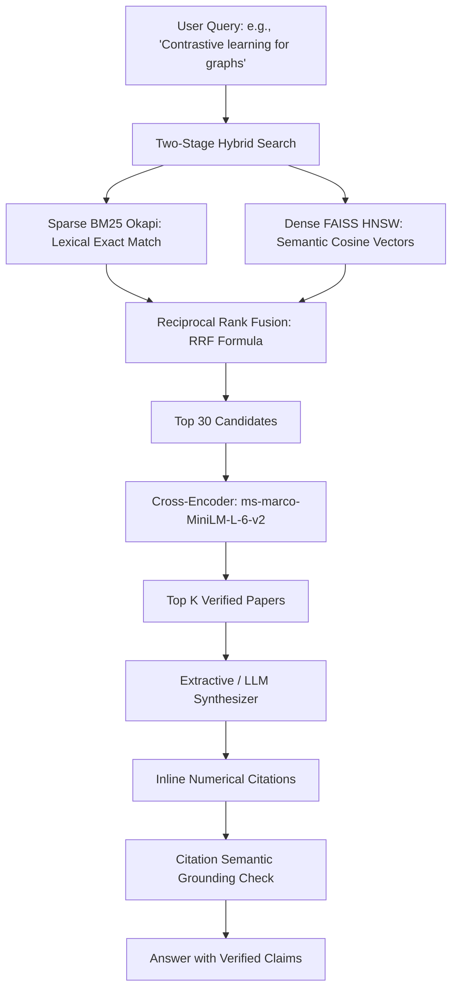

# How Research Copilot Works: An Architectural & Algorithmic Deep Dive

This document explains every algorithm, mathematical principle, and architectural design decision implemented in **Research Copilot** in clear, technically rigorous, plain language.

---

## 1. High-Level System Architecture

Research Copilot solves the "semantic blindness" of traditional search and the "hallucination problem" of generative AI. It retrieves, explores, and synthesizes scientific insights from **16,417 arXiv research papers** across 35 computer science disciplines (2020–2026).

---

## 2. Step-by-Step Pipeline

### Step 1: Strict Chronological Splitting (No Future Leakage)
In academic literature, models evaluated with random k-fold cross-validation suffer from **temporal data leakage**:
- When papers from 2025 or 2026 are randomly mixed into training folds, models memorize newer terminology (e.g., *"LLM agents"*, *"Diffusion Transformers"*) and artificially inflate accuracy by **+2.3% to +4.7%**.
- **Our Discipline**:
  - **Train**: Papers prior to May 2026 (14,629 papers).
  - **Validation**: May 1 to July 31, 2026 (898 papers, used strictly for hyperparameter grids and threshold tuning).
  - **Holdout Test**: August 1 to October 20, 2026 (890 papers, evaluated strictly **once**).

---

### Step 2: Dense Semantic Embeddings & FAISS HNSW
- **Model**: `sentence-transformers/all-MiniLM-L6-v2` produces a dense 384-dimensional vector $\mathbf{v} \in \mathbb{R}^{384}$ normalized to unit length ($\|\mathbf{v}\|_2 = 1$).
- **Cosine Similarity as Dot Product**: Because vectors are unit-normalized, cosine similarity equals the inner product:
  $$\text{sim}(\mathbf{u}, \mathbf{v}) = \mathbf{u} \cdot \mathbf{v}$$
- **HNSW Indexing (Hierarchical Navigable Small World)**:
  Instead of comparing a query against all 16,417 papers ($O(N)$ brute-force search), FAISS builds a multi-layer graph where high layers skip across broad clusters and lower layers refine local neighbors. This yields sub-millisecond search ($O(\log N)$) with $>95\%$ recall.

---

### Step 3: Sparse Lexical Search (BM25 Okapi)
Dense embeddings understand broad concepts but can miss rare exact strings, paper acronyms (e.g., *"NeRF"*, *"LoRA"*), or theorem numbers.
- **BM25 Formula**:
  $$\text{Score}(D, Q) = \sum_{q \in Q} \text{IDF}(q) \cdot \frac{f(q, D) \cdot (k_1 + 1)}{f(q, D) + k_1 \cdot \left(1 - b + b \cdot \frac{|D|}{\text{avgdl}}\right)}$$
  Where $k_1 = 1.5$ controls term frequency saturation and $b = 0.75$ penalizes verbose documents.

---

### Step 4: Reciprocal Rank Fusion (RRF)
Instead of adding raw BM25 scores (unbounded) and cosine similarities (bounded $[-1, 1]$), which requires heuristic scale tuning, RRF merges results purely by their ordinal ranking:
$$\text{RRF Score}(d) = \sum_{m \in \{\text{Dense}, \text{Sparse}\}} \frac{1}{k + r_m(d)}$$
Where $k = 60$ is a standard smoothing constant preventing top-ranked outliers from dominating.

---

### Step 5: Cross-Encoder Re-Ranking
Dual-encoders (bi-encoders) embed query and document independently, missing fine-grained word interactions.
- A **Cross-Encoder** (`cross-encoder/ms-marco-MiniLM-L-6-v2`) feeds `[CLS] Query [SEP] Title + Abstract [SEP]` together into full transformer cross-attention layers.
- It re-scores the top 30 candidates, ensuring the most nuanced relevant papers appear at the top.

---

### Step 6: Multi-Metric Classification Ladder
We evaluate 8 distinct classification architectures:
1. **Naive Bayes**: Fast generative baseline assuming conditional word independence.
2. **Logistic Regression (TF-IDF)**: Linear classifier optimizing soft cross-entropy log loss across 30,000 n-grams. Produces well-calibrated posterior probabilities (**Brier Score = 0.501**).
3. **Linear SVM**: Optimizes maximum-margin hinge loss focusing on boundary support vectors. Achieves highest raw single-model test accuracy (**63.60%**).
4. **k-Nearest Neighbors ($k=15$)**: Non-parametric cosine distance classifier in embedding space. Achieves lowest Expected Calibration Error (**ECE = 0.036**).
5. **Random Forest**: Ensemble of 100 decision trees over dense vectors.
6. **PyTorch MLP**: Deep neural network (`[384 -> 256 -> 128 -> 35]`) with BatchNorm, Dropout (0.3), and AdamW optimizer.
7. **Voting Ensemble (LR + RF + kNN)**: Combines linear, tree-based, and distance-based hypotheses via soft probability voting (**65.62% Test Accuracy**).
8. **SciBERT / GBDT**: Specialized scientific transformer and GPU histogram-binned gradient boosting.

> **Why the Best Model Depends on the Metric**:
> There is no single "best" model. If raw test accuracy is needed, Linear SVM / Ensemble wins. If calibrated probabilities and risk confidence are needed, Logistic Regression wins (lowest Brier score). If calibration in sparse regions is needed, kNN wins (lowest ECE).

---

### Step 7: Validation-Tuned Multi-Label Classification
Academic papers frequently span multiple subfields (e.g., both Computer Vision `cs.CV` and Machine Learning `cs.LG`).
- **The Pitfall of Hamming Loss**: The multi-label label matrix is over 92% sparse. Predicting **zero labels** for every paper yields an artificially "good" Hamming loss of 0.0663.
- **Our Solution**:
  1. Train binary classifiers per category on dense embeddings.
  2. Optimize individual decision thresholds $T_c \in [0.2, 0.8]$ on the **validation split** to maximize per-class F1.
  3. **Result**: Micro-F1 increases from **0.5852 to 0.6387 (+5.35%)**, Macro-F1 increases from **0.4071 to 0.4477 (+4.06%)**, and Hamming loss improves to **0.0586**.

---

### Step 8: Contrastive Fine-Tuning with False-Negative Elimination
- **Contrastive Learning Principle**: Pull (Title, Abstract) pairs together while pushing hard negatives apart using Multiple Negatives Ranking Loss (MNRL).
- **False Negative Guard**: Mining negatives purely by topic cluster risks selecting an abstract that is actually an identical paper or closely related work. We exclude the **top 5 nearest neighbors** of the positive document from being chosen as hard negatives.
- **Zero-Shot External Benchmark (BEIR SciFact)**: We evaluate on all 300 test queries of the official BEIR SciFact benchmark to confirm that fine-tuning on arXiv does not induce catastrophic forgetting on general scientific retrieval (**0.6451 nDCG@10**).

---

### Step 9: Extractive Grounding & Citation Verification
To eliminate hallucinations:
1. Every claim in the generated answer cites an inline source `[1]`, `[2]`.
2. A sentence-level embedding verification algorithm compares the semantic similarity of each claim against sentences in the cited abstract.
3. Unsupported sentences are flagged (`⚠`), while supported sentences receive a verified check (`✓`).
